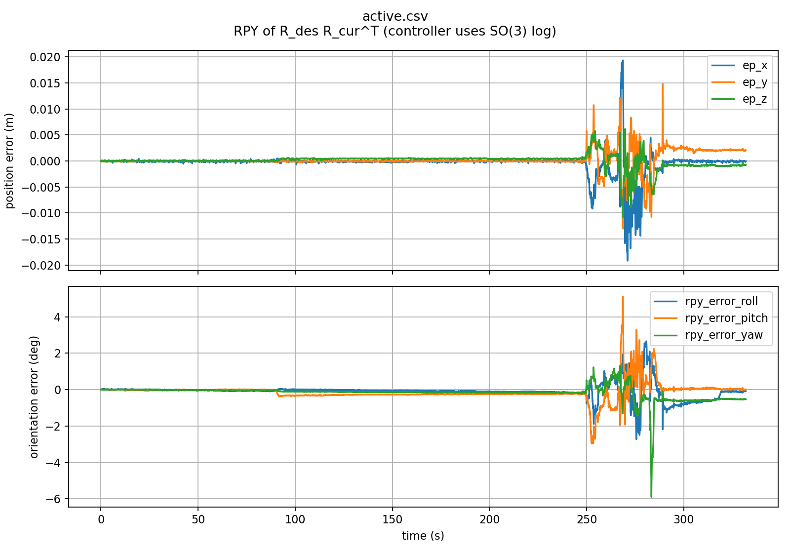
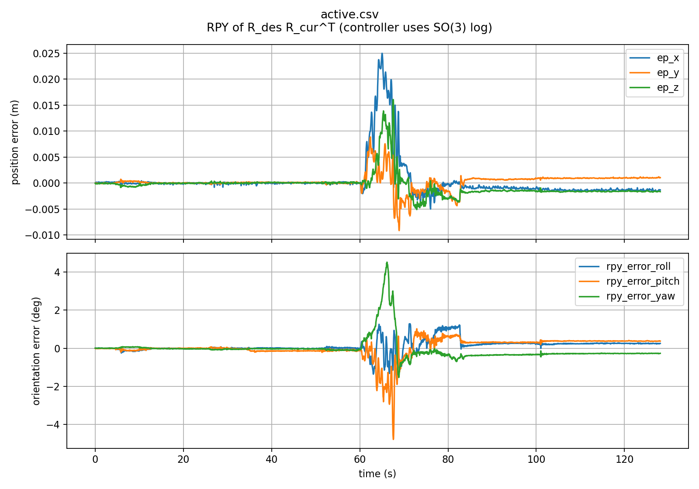

# Phase 2：可关闭的速度前馈

Phase 1 已冻结：提交 `1e9ae76`，标签 `link6-world-hold-phase1-20260924`。
该基线完成过约 **10 cm / 5 s** 手动水平 base 扰动：峰值误差 34.18 mm / 3.99°，末段 10 s 均值 2.51 mm / .82°。
这些是 SLAM+编码器重建的误差，非独立计量。扩大实验记录、误差图及复现命令见 [EXTENDED_RESULT_20260924.md](EXTENDED_RESULT_20260924.md)。

开发分支：`agent/link6-velocity-feedforward`。0.25 / 0.25 速度前馈已完成真实 **3、5、7.5、10 cm / 5 s** 人工水平 base 扰动验证。最新新构型的 7.5 cm 和反方向 10 cm 两轮均持续补偿、停住后稳定，无保护退出。
10 cm 一轮 joint5 新增跟踪误差峰值约 0.0783 rad，接近既有 0.08 rad 阈值，因此没有继续扩大幅度或提高速度。此前旧构型失败试验保留在下文；不能把最新成功推广到任意姿态或六方向快速扰动。
默认两个 feedforward gain 均为 0，原 Phase 1 参数和行为保留。没有加入加速度、SMC/NMPC、base 位姿估计器或状态预测。

## 计算

`/slam/camera_twist` 的源码确认：线速度在 camera_link 原点，角速度和线速度均以 orb_map 表示，时间戳与 camera_pose 相同。
相机固定在 housing，所以不能把 camera twist 直接当作 link6 twist，也不能把机械臂主动补偿产生的速度再次当成外部扰动。

在同一图像时刻 `s`，用已标定的相机 frame 和编码器计算：

```text
V_external_C = V_camera_measured - J_camera_world(q_s) * dq_s
r = p_world_link6(s) - p_world_camera(s)
V_external_E.linear  = V_external_C.linear + V_external_C.angular × r
V_external_E.angular = V_external_C.angular

V_E_measured = J_link6_world(q_s) * dq_s + V_external_E
V_feedforward = -G * deadzone(V_external_E)
V_command = clamp(Kp * pose_error + clamp(V_feedforward))
```

随后沿用原六列 link6 Jacobian、阻尼伪逆、关节限速及已有位置积分接口。
q6 的相机 Jacobian 列为零；q6 的 link6 角速度贡献保留。这个前馈是直接运动学速度分离，不积分/估计 world→base pose。
它与 `-Kd * V_E_measured` 速度反馈阻尼不同，本次没有把两种项混在一起。

编码器位置在图像时间戳插值，关节速度用同一时刻附近默认 100 ms 的短窗直线拟合，降低量化噪声。
窗口必须包含该图像时刻，有至少 4 个样本、跨度至少半个窗口，相邻反馈间隔不超过 40 ms；不外推到未来。
Pose/Twist 必须同 stamp，且不能比最新 Pose 落后超过 80 ms。
这只是输入对齐，没有把滞后的 SLAM 状态预测到当前时刻。

## 参数与退出

所有参数在 `camera_world_hold.yaml`，启动时读取：

| 参数 | 默认 | 含义 |
|---|---:|---|
| velocity_feedforward_linear_gain / angular_gain | 0 / 0 | 范围 0–1；0 关闭该部分 |
| feedforward_max_linear_velocity | .03 m/s | 前馈自身限幅，叠加后仍受原总限幅 |
| feedforward_max_angular_velocity | .10 rad/s | 同上 |
| feedforward_linear_deadband | .003 m/s | 静止速度噪声死区 |
| feedforward_angular_deadband | .01 rad/s | 静止角速度噪声死区 |
| joint_velocity_window | .10 s | 编码器拟合窗口 |
| twist_receive_timeout | .20 s | Twist 接收看门狗 |
| feedforward_max_sample_lag | .08 s | 与最新 Pose 的最大时间戳落后 |

Twist 缺失、错 frame、非有限值、过期或无法匹配时，**当周期前馈清零，继续原 P 控制**，不会保留旧速度。
Pose 接收中断、SLAM invalid、关节反馈中断仍按 Phase 1 退出 HOLD，恢复后须重新 enable。
`ff_valid/ff_reason` 明确区分前馈是否生效。

新增诊断：`~/feedforward_twist`、`~/external_link6_twist`、`~/measured_link6_twist`。
后两个 topic 使用匹配的图像时间戳；命令 topic 使用命令时刻。
CSV 同时记录 camera velocity、自身运动速度、外部扰动速度、前馈、匹配时间戳、延迟及有效性。
电机命令中的 velocity 字段仍为 0，所有补偿最终都通过位置指令执行。

## 已完成验证

- 完整测试 **65 passed**：原 P 回归、所有六列 Jacobian、混合 base/关节运动有限差分、q6、杆臂、对齐、限幅、丢失/错 frame/NaN 回退、隔离 ROS 通信。
- 理想运动学闭环中，前馈能在 pose error 尚为零时产生反向补偿；降低运动误差。这不是动态仿真或硬件性能证明。
- Python syntax/import、ROS package build 通过。
- 真机自运动检验：q6 约 +2.945° 时，相机转角 0.026°、重建 link6 转角 2.961°；q6 约 −5.297° 时分别为 0.045° / 5.262°。符合 housing 固定相机的结构。
- 3 cm 往返 base shadow：移动样本中 91.35% 的前馈方向与位姿差分速度相反，中位方向余弦 0.972。手动运动不严格沿单轴，自运动扣除仍有瞬态残差。
- 真实前馈 0.25 / 0.25、约 3 cm / 5 s：峰值位置误差 22.39 mm、姿态误差 2.51°；实际接入窗口末 10 s 均值 2.13 mm / 0.746°，无保护退出。用户确认反向补偿、停住后稳定。输入未独立测量，不能据此计算相对纯 P 的改善百分比。
- 修复后真实 5 cm / 5 s 重试：峰值 20.37 mm / 4.63°，末 10 s 均值 1.38 mm / 0.655°；末 30 s 肩/肘关节位置不再变化，腕部反馈跨度不超过 0.044°，无保护退出。数据位于 `ff25_5cm_fixed/`。
- 7.5 cm / 5 s、指令上限 0.12 rad/s：用户观察到初始补偿后停止，日志确认 joint5 新增跟踪偏差 −0.08015 rad，超过既有 0.08 rad 保护。驱动无速度故障；该轮不是成功稳定实验。保留保护阈值，将 bridge 指令速度降至 0.08 rad/s、人工扰动放慢到约 10 s 后，joint5 新增跟踪偏差仍达到 +0.08057 rad 并退出。后续单关节 ±2° 试验确认显著小幅响应滞后；按用户要求恢复此前成功的构型，再复测。
- 首次 5 cm 重试前，bridge 因单次循环间隔超过 30 ms 退出；用户移动时只有驱动保位。这不是前馈收敛失败。修复后单次位置积分仍最多 30 ms，不追赶积压；循环间隔超过 100 ms 仍退出。新增测试覆盖该行为，bridge 测试 7 passed。
- 长期视觉积压仍存在；旧 SLAM 在 MapPoint::ComputeDistinctiveDescriptors 中崩溃过，OpenCV 单线程未彻底解决。另一次重启在 BA2 完成时发生初始化地图跳变并被保护锁存。新会话延后输出初始化原点；不放宽闭环 pose 接收看门狗。

数据：软件测试位于 `log/link6_demo_20260924/extended/phase2_tests.log`；本轮实测位于 `log/link6_phase2_20260924/`，其中 `ff25_trial/active.csv`、`active.png`、`metrics.json` 是实际接入窗口的数据。

## 下次只读 shadow 命令

先复用既有相机、SLAM、机械臂保位会话，确认只有一个 controller，没有运动 bridge。**这些命令本身不接入电机。**

```bash
cd ~/westlake/windy-arm
source /opt/ros/humble/setup.bash
source install/setup.bash
export ROS_DOMAIN_ID=95 ROS_LOCALHOST_ONLY=1
export OPENBLAS_NUM_THREADS=1 OMP_NUM_THREADS=1
ros2 run manipulator camera_world_hold_controller.py --ros-args \
  --params-file src/arm-platform/config/camera_world_hold.yaml \
  -p publish_command:=false \
  -p velocity_feedforward_linear_gain:=0.25 \
  -p velocity_feedforward_angular_gain:=0.25 \
  -p log_path:=$PWD/log/phase2_next_shadow.csv
```

另一个同环境终端，在 READY 后抓取当前 link6 目标，进行 shadow 计算：

```bash
ros2 service call /camera_world_hold/enable std_srvs/srv/SetBool '{data: true}'
# 结束：
ros2 service call /camera_world_hold/enable std_srvs/srv/SetBool '{data: false}'
```

当前真实接入沿用 Phase 1 的 position bridge；其执行状态必须与 controller HOLD 同时核实。bridge 退出后会 disable controller 并交回驱动保位，重新开始需要显式接入和 enable。


## 当前中断与修复记录

- `restore_posture` 分三段低速恢复，最终关节角约 `[24.75, 71.44, -63.07, -44.45, 62.87, 18.19]` 度；无跟踪/驱动保护退出。不能据此宣称消除了 joint5 小幅响应滞后。
- 恢复后的 5 cm 提示因 SLAM 接收中断取消，未取得有效扰动结果。该会话运行约十多分钟后再次出现积压。
- 停机栈同时看到 LocalMapping 的 `MapPoint::ComputeDistinctiveDescriptors` 和 Tracking 的 `GetObservations`。前者原来使用 `float Distances[N][N]` 栈数组并逐行排序；旧会话也曾在同函数崩溃，但没有核心转储证明具体崩溃指令。
- ORB 局部修复保留全部观测权重和原 lower-median / first-tie 规则，以重复描述子压缩和整数距离直方图替代平方栈数组/排序。1000 组独立参考算法比较、并列/重复数据及 10000 次观测测试通过 ASan/UBSan。核心库编译、Atlas map epoch 回归通过。现场长时验证仍待完成，不宣称已根治积压。
- 原 ORB 库、MapPoint.cc 和已有工作区差异保存在 `log/link6_phase2_20260924/orb_before_descriptor_fix/`；Phase 1 tag 未移动。


### 后续构型与对照（同日）

- 恢复旧姿态后，0.25 / 0.25 前馈的 5 cm / 5 s 再次成功：峰值 12.42 mm / 2.97°，实际接入末 10 s 均值 1.36 mm / 0.967°，用户确认补偿后停稳。`restored_ff25_5cm/`。
- 随后 7.5 cm 前馈复核仍触发 joint5 增量跟踪误差 +0.08023 rad，指令累计 +6.36°、实际 +1.76°；不能算通过。`restored_ff25_75cm/`。
- 用户认为姿态仍不合适，按六轴 `[0,60,-60,0,60,0]` 度参考重新分三段调整。实际约 `[-0.7,60.9,-59.8,-0.3,62.4,-0.1]` 度，条件数约 18.7，全程无保护退出；用户确认构型合适。`centered_stage1..3/`。
- 新构型临时关闭前馈做纯 P 7.5 cm / 5 s：用户确认持续补偿、停稳；峰值 24.21 mm / 2.90°，视觉退出前约 2.99 mm / 0.56°。随后 SLAM 接收中断，未完成完整的停稳后 20 s 闭环观察。`centered_p75/`。
- 描述子修复后的 15 分钟监测全部 SLAM valid，窗口内最大接收间隔 166 ms，但后段帧率降到约 26 Hz，随后仍触发超时。不能宣称该修复单独根治长时积压。`descriptor_long_watch.jsonl`。
- 第二个局部修复针对 Tracking 更新 local keyframes 时重复复制每个地图点的观测树：复用受锁保护的指针快照，哈希投票后转换回原有排序；保留全部票数及相同的并列选择顺序。核心库编译、3 个回归测试通过，包括并发快照和原投票顺序等价测试。新会话静止预检约 30 Hz，最大接收间隔 40 ms；长时效果尚在验证，不放宽看门狗。
- ORB 修复分别提交为 `8c71b4d`（描述子）和 `20e353a`（观测快照/投票）；此前已有 profiling 等工作区修改未纳入提交。新 SLAM 会话使用 `origin_settle_time_sec:=60.0`，在 BA2 后建立新原点，每次重启重新抓取 HOLD 目标。

### 新构型前馈复核

- `centered_ff25_75/`：0.25 / 0.25 前馈、0.12 rad/s 关节指令上限，人工约 7.5 cm / 5 s。用户确认完成补偿并稳定，全接入窗口无跟踪保护退出；结束时主动 disable 并交回驱动保位。峰值 25.58 mm / 6.12°，末 10 s 均值 2.27 mm / 0.532°；末 10 s 肩/肘编码器无变化，腕部最大跨度 0.11°。人工输入幅度和方向没有独立测量，不能将不同轮峰值直接解释为前馈改善比例。

- `centered_ff25_10/`：相同参数，沿上一轮反方向人工约 10 cm / 5 s。用户确认“补偿持续，完成后稳定”；实际接入 128.27 s，无保护退出。峰值 **27.18 mm / 5.49°**，末 10 s 均值 **2.31 mm / 0.530°**；末 10 s 前三轴反馈无变化，腕部最大跨度 0.044°。Jacobian rank=6，条件数约 15.52–18.80。joint5 近似新增跟踪误差峰值 0.07828 rad，未放宽 0.08 rad 保护；据此停止扩大试验。




误差图覆盖实际接入窗口（包括等待人工动作的静止段），不包含退出后的保位数据。表中姿态标量为 SO(3) rotation-vector 范数；图中逐轴是误差旋转的 RPY。输入是人工移动，误差来源仍是 SLAM+编码器重建，不能据此宣称相对纯 P 的定量改善。

## 复现已验证前馈参数

复用已运行的 D435i、SLAM 和机械臂保位驱动。冷启动驱动、支撑与新鲜 hold seed 流程见 [Phase 1 记录](EXTENDED_RESULT_20260924.md#复现当前配置)；不要重用旧 seed 或重复占用设备。
相机仍在运行但需重启 SLAM 时，在原 SLAM 完全停止后使用（初始化完成之前不接通补偿）：

```bash
cd ~/westlake/windy-arm
source /opt/ros/humble/setup.bash
source ~/westlake/ORB-SLAM3/ros2_install/setup.bash
source install/setup.bash
export ROS_DOMAIN_ID=95 ROS_LOCALHOST_ONLY=1
export OPENBLAS_NUM_THREADS=1 OMP_NUM_THREADS=1
mkdir -p log/ff025_reproduce
ros2 run orb_slam3_ros2 stereo_inertial_node --ros-args \
  --params-file ~/westlake/ORB-SLAM3/ros2_install/orb_slam3_ros2/share/orb_slam3_ros2/config/d435i.yaml \
  -p use_viewer:=false -p opencv_threads:=1 \
  -p max_pending_frames:=2 -p max_path_poses:=300 \
  -p origin_settle_time_sec:=60.0 \
  -p trajectory_path:=$PWD/log/ff025_reproduce/trajectory.tum
```

同样环境下，controller 启动为 READY，保持 `publish_command=false`：

```bash
/usr/bin/python3 src/arm-platform/demo/camera_world_hold_controller.py --ros-args \
  --params-file src/arm-platform/config/camera_world_hold.yaml \
  --params-file src/arm-platform/config/camera_world_hold_ff025.yaml \
  -p log_path:=$PWD/log/ff025_reproduce/controller.csv
```

实际运动由 bridge 执行。另一个同环境终端运行；每次实验使用新的 output 目录：

```bash
/usr/bin/python3 src/arm-platform/demo/camera_world_hold_position_bridge.py \
  --execute --duration 0 --speed .12 --max-offset-deg 40 \
  --output log/ff025_reproduce/trial
```

看到 `BRIDGE READY` 后 30 秒内，在另一个终端 enable，抓取当前 link6 pose：

```bash
ros2 service call /camera_world_hold/enable std_srvs/srv/SetBool '{data: true}'
# 结束补偿并交回驱动保位：
ros2 service call /camera_world_hold/enable std_srvs/srv/SetBool '{data: false}'
```

前馈 preset 仅覆盖两个增益，已逐字段核对合并后的参数与现场 `controller_ff25.yaml` 相同。省略 overlay 即恢复默认纯 P；Phase 1 冻结标签保持不变。最后一次真实实验已主动 disable，机械臂由原驱动保位，不会自动恢复旧目标。

视觉修复后的实测限制：两轮成功扰动期间未出现 SLAM invalid 或接收超时。10 cm 实验主动退出约 21 秒后，静止保位记录出现 3 个 invalid 消息（SLAM 报 local-map tracking lost），随后恢复；这不属于已结束实验的闭环窗口，但说明视觉连续有效性仍不能保证。不能宣称长时可靠性问题已全部解决。会话哈希及已有工作区差异保存在 `log/link6_phase2_20260924/phase2_freeze/`，完整 rosbag 已正常停止并写入 metadata。
