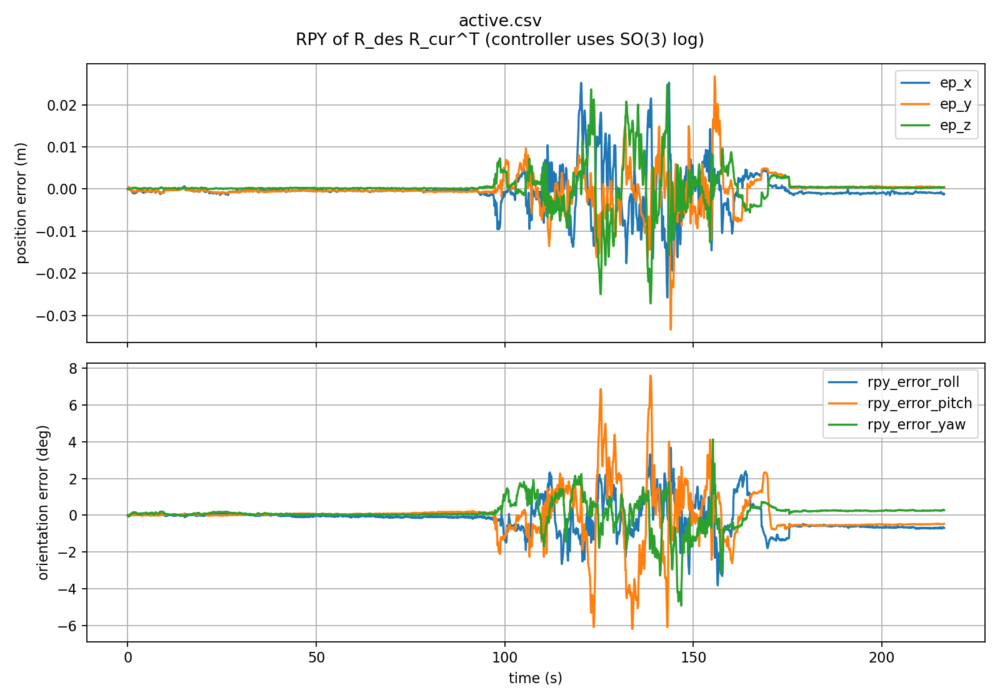

# link6 三维抗扰演示与 RViz 录屏

沿用已验证的 P + 0.25 / 0.25 速度前馈，关节指令限速 0.12 rad/s。
本次没有修改控制算法或放宽保护。默认纯 P 和前馈阶段标签保持原样。

## 画面

- 灰色机械臂：URDF 实际模型，由关节反馈和重建 link6 pose 放置在 orb_map。
- 青色：实际 link6 原点及其轨迹；金色框：本次 enable 抓取的目标。
- 金色轨迹：由相同 FK/视觉几何得到的基座显示轨迹，仅用于展示，不是独立测量或控制输入。
- 三色坐标轴：目标与实际末端朝向；数字为位置误差范数和 SO(3) 旋转误差范数。
- `LIVE-COMPENSATION` 同时要求 controller HOLD、实际位置桥接指令持续发布、测量新鲜。
  `POSITION-HOLD / COMPENSATION-OFF` 表示未接通补偿，不能当作正在稳定末端。

可视化节点仅发布 MarkerArray，不发布 TF 或任何电机指令；不会建立新的 base estimator。
显示轨迹自动在下一次接通时清空，最多保留约 120 秒。

## 启动可视化

先按 [已验证前馈记录](VELOCITY_FEEDFORWARD.md#复现已验证前馈参数) 启动真实状态与控制。
以下命令本身只显示，不使机械臂运动：

```bash
cd ~/westlake/windy-arm
source /opt/ros/humble/setup.bash
source install/setup.bash
export ROS_DOMAIN_ID=95 ROS_LOCALHOST_ONLY=1
export OPENBLAS_NUM_THREADS=1 OMP_NUM_THREADS=1
/usr/bin/python3 src/arm-platform/demo/link6_hold_visualizer.py
```

另一同环境终端：

```bash
rviz2 -d src/arm-platform/config/link6_world_hold_video.rviz
```

## 单独录制 RViz

保持 RViz 窗口可见，使用 `xwininfo -root -tree` 获取当前 RViz 的十六进制窗口 ID。
ID 每次启动可能改变，不复用文档示例值。使用已安装的 PyQt5 和 OpenCV，不要求额外 ffmpeg 可执行文件。

```bash
/usr/bin/python3 src/arm-platform/demo/record_rviz_window.py \
  --window-id <本次RViz窗口ID> \
  --output log/my_link6_demo.mp4 --fps 15 --width 1280 --duration 600
```

输出只捕获所选窗口，不录制实机或声音。用 Ctrl-C 结束并正常写入 MP4；录屏达到时限不会改变机械臂控制状态。
录屏角落显示实际经过时间，便于发现采集掉帧；手机实机视频另行拍摄。不要在录制时最小化或遮挡 RViz。

演示结束后必须单独关闭真实补偿，交回原驱动保位：

```bash
ros2 service call /camera_world_hold/enable std_srvs/srv/SetBool '{data: false}'
```

## 验证与数据

Python 编译及实际节点启动通过；ROS 检查收到连续 MarkerArray、真实模型和目标框，发布接口仅为 markers、日志和参数事件。
3 秒录屏检查产生 46 帧 MP4，成功解码并人工检查画面。

数据目录：`log/link6_phase2_20260924/`。
首次 `video_3d/` 在用户触碰相机后取消，不能计为三维试验通过。
用户确认安装位置/朝向未变且停稳后，重新捕获目标，正式拍摄记录为 `video_3d_retry/`。
录屏：`link6_3d_demo_rviz.mp4`；包含可视化与控制状态的 ROS bag：`video_bag/`。

## 本次完成结果

用户完成三维移动/小角度转动拍摄，并回复“拍完了”。`video_3d_retry` 实际补偿接入 216.68 秒，无跟踪保护退出；收到回复后主动 disable，驱动保位，RViz 保留。

- 峰值重建误差：36.15 mm / 8.42°。
- 最后 10 秒平均：1.10 mm / 0.878°；最后 30 秒平均：1.14 mm / 0.858°。
- 最后 10 秒前三轴反馈无变化，后三轴最大跨度 0.044°。
- Jacobian 条件数约 14.50–16.74。

误差来自 SLAM+编码器，不是独立计量；人工三维输入幅度没有独立测量。本轮完成阶段演示，不据此宣称任意六方向扰动均达到上述精度。



MP4 原始录屏 3594 帧、1280×740，无音频；首/中/末帧解码通过，完整 ROS bag 已关闭并写入 metadata（362114 条消息、14 个 topic）。
原始 Qt 粗定时器采集速度略高于名义 15 fps；按实测 230.06 秒录制时间保留全部帧、统一校正播放帧率，导出 `link6_3d_demo_rviz_realtime.mp4`，原文件不覆盖。视频左下角有实际经过时间；它不是逐帧硬件同步记录。
录制工具已改为精确定时器和按经过时间计算输出帧数，避免后续录屏播放速度漂移。

`colcon build --packages-select manipulator` 通过。所有新增工具只负责显示/录屏；控制器及其参数没有改动。

