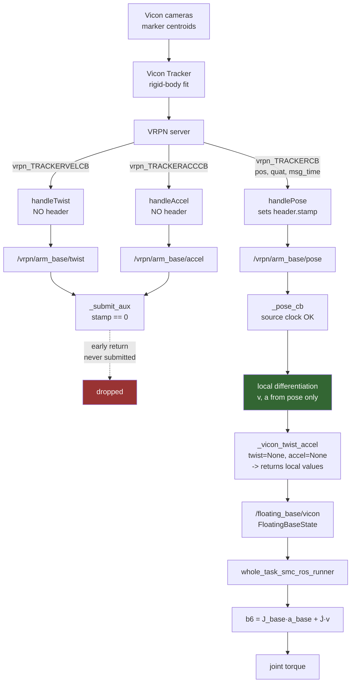

# Base Acceleration Pipeline

How `a_base` reaches the controller, written out in full.

Line references marked *(arm)* point into this repository; *(vicon)* points into the
`vicon_perception` repository, which supplies `vrpn_listener`.

The short version: **there is exactly one sensor, and exactly one code path.** Vicon
measures the pose of a rigid marker cluster. Every velocity and acceleration the
controller consumes — linear and angular alike — is produced by differentiating that
pose inside `vicon_floating_base_bridge`. The VRPN twist and accel topics are
subscribed, published, and then silently dropped before they reach the assembler.

---

## 1. Notation

| Symbol | Meaning |
|---|---|
| $R$ | marker-cluster origin (what Vicon actually reports) |
| $B$ | `base_link` origin (what the controller needs) |
| $\mathbf{r}$ | lever arm $R \to B$, $\lVert\mathbf{r}\rVert = 33.1$ mm |
| $q_{vr}$ | raw rigid-body attitude from VRPN |
| $q_{wv}, q_{rb}$ | fixed extrinsics: vicon_world→ctrl, rigid→base_link |
| $\boldsymbol{\omega}, \boldsymbol{\alpha}$ | base angular velocity / acceleration |
| $\mathbf{a}_B$ | base_link linear acceleration |
| $\tau_f$ | EMA time constant, `filter_time_constant_sec` = 0.04 s |
| $\Delta t$ | Vicon frame period, $\approx$ 8 ms |

`_lwa` throughout the code means LOCAL_WORLD_ALIGNED: components on world axes,
origin at the body.

---

## 2. What is actually running



Effective source of every quantity, as deployed:

| Quantity | Launch flag | Flag default | **Effective source** |
|---|---|---|---|
| base linear velocity | `prefer_vicon_twist` | `true` | local 1st difference |
| base angular velocity | `prefer_vicon_twist` | `true` | local 1st difference |
| base linear acceleration | `prefer_vicon_linear_accel` | `true` | local 2nd difference |
| base angular acceleration | `prefer_vicon_angular_accel` | `false` | local 2nd difference |

**The four `prefer_vicon_*` flags currently have no effect.** Their values do not
matter, because the data they select never arrives. §3 shows why.

---

## 3. Why the VRPN twist/accel topics never reach the controller

### 3.1 The listener publishes no header on twist/accel

`src/vrpn_listener/src/vrpn_listener.cpp` *(vicon)*. `handlePose` sets both fields:

```cpp
pose_msg.header.frame_id       = listener->_frame_id;
pose_msg.header.stamp.sec      = poseData.msg_time.tv_sec;
pose_msg.header.stamp.nanosec  = poseData.msg_time.tv_usec * 1000;
```

`handleTwist` and `handleAccel` set **neither**. They populate only the payload and
publish. Every twist and accel message therefore carries `stamp = 0` and
`frame_id = ""`.

### 3.2 The bridge drops unstamped aux messages by design

`SourceClockAligner.source_time` (`core/base_state_fusion.py`, around lines 65–74)
*(arm)* returns `None` for a non-positive stamp; `align` (around lines 83–89) then
returns `used_source = False`. `_submit_aux` (`hw/vicon_floating_base_bridge.py`,
around lines 456–471) *(arm)* returns immediately:

```python
if not aligned.used_source:
    # ... 这条通道因此永远不会 submit ...
    return
```

The comment names the measurement: 5156 of 5156 messages had `stamp == 0`.

### 3.3 Consequence

The aux channels never enter `FrameAssembler`, so a base frame is complete as soon as
the pose arrives. `_vicon_twist_accel` is then called with `twist=None, accel=None`
and takes its early return (around line 739) *(arm)*:

```python
if twist is None and accel is None:
    return v, a, used_twist, used_accel, skew_sec   # local values, flags False
```

`_used_vicon_twist` and `_used_vicon_accel` are permanently `False`. Diagnostics
index 5 will read 0.0 for the entire run.

**This is deliberate**, not an oversight. The `_submit_aux` comment calls it
「修复前也能部署」的那条路径 — the path that lets the system deploy before the
listener is fixed.

### 3.4 Even with the stamp fixed, the angular fields are still not angular rates

Three independent defects in `handleTwist` / `handleAccel` *(vicon)*:

**(a) `vel_quat_dt` and `acc_quat_dt` are never read.** VRPN's convention is that
`vel_quat` expresses the rotation occurring over the interval `vel_quat_dt`; recovering
a rate requires dividing by it. The listener does not.

**(b) The quaternion is converted to Euler angles, not a rotation vector:**

```cpp
tf2::Matrix3x3 rot_mat(tf2::Quaternion(accelData.acc_quat[0..3]));
rot_mat.getRPY(roll, pitch, yaw);
accel_msg.accel.angular.x = roll;   // radians, not rad/s^2
```

Roll-pitch-yaw agrees with a rotation vector only for small angles, and carries the
usual gimbal degeneracy.

**(c) The quaternion magnitude is silently discarded.** `tf2::Matrix3x3::setRotation`
scales by $s = 2/\lVert q\rVert^2$, which normalises implicitly. The bridge's docstring
(around lines 758–765) *(arm)* records a measured

$$
q_{vel} = [0.0,\, -0.0265,\, 0.1783,\, -0.0338], \qquad \lVert q_{vel}\rVert = 0.183
$$

Whatever that norm encodes is lost.

So `/vrpn/*/accel.angular` is in **radians**, not rad/s². Fixing the header stamp alone
would make the bridge start trusting a mis-scaled signal — the cross-check gate in
`_vicon_twist_accel` would then be the only thing standing between it and the torque
command.

### 3.5 The linear fields, by contrast, are fine

```cpp
accel_msg.accel.linear.x = accelData.acc[0];   // copied straight through
```

`acc[3]` and `vel[3]` are plain VRPN linear quantities in m/s² and m/s. **A header-stamp
fix alone would make the linear channels usable.** That is the cheap win, and it is
independent of the angular problem.

### 3.6 Two further listener observations

- Publisher queue depth is **1** (`create_publisher<...>(topic, 1)`) on all three
  topics. The bridge subscribes with depth 200 after measuring 4.5–14% in-node frame
  loss at depth 10. Depth 1 on the publish side can drop frames before the subscriber
  is ever involved.
- `launch/vrpn_client.launch` declares `<arg name="server" default="localhost"/>` but
  never passes it to the node — the node reads `config/params.yaml` only. That file
  currently holds `server: 192.168.50.96`, which does not match the confirmed lab
  address `192.168.200.60:3883`. Set it in `params.yaml` or override the parameter;
  the launch arg does nothing.

---

## 4. The path that is actually used, step by step

### 4.1 Pose transform

`_transform_pose`, around lines 367–387 *(arm)*:

$$
q_{wb} \;=\; q_{wv} \otimes q_{vr} \otimes q_{rb}
$$

$$
\mathbf{p}_{wb} \;=\; \mathbf{t}_{wv} + R(q_{wv})\,\bigl(\mathbf{p}_{vr} + R(q_{vr})\,\mathbf{t}_{rb}\bigr)
$$

then, when `zero_on_first_pose` is set, re-reference to the first frame:

$$
q_{wb} \leftarrow q_0^{*} \otimes q_{wb}, \qquad
\mathbf{p}_{wb} \leftarrow R(q_0^{*})\,(\mathbf{p}_{wb} - \mathbf{p}_0)
$$

These are all **constant** rotations. They set the frame the derivatives are expressed
in; they do not change their magnitude. The extrinsic $q_{rb}$ carries an 85.3°
rotation — `config/vicon_extrinsics.yaml` warns that omitting it tilts the entire
controller world frame by 85°.

### 4.2 Choosing the clock

`_pose_cb`, around lines 897–905 *(arm)*. Sample time is VRPN's `msg_time` when
nonzero, arrival time otherwise. Pose is the one channel where this works, because
`handlePose` is the one handler that sets the stamp (§3.1).

Why it matters, from `core/base_state_fusion.py` around lines 3–5 *(arm)*:

> 求导必须用源时钟：拿真实 8 ms 的位移去除以 0.09 ms 的到达间隔，速度会被放大约 90 倍

Packets arrive batched at $\approx$ 0.09 ms spacing; the real frame period is 8 ms.

### 4.3 First difference

`_emit_base_frame`, around lines 949–958 *(arm)*. The incremental rotation is

$$
\delta q \;=\; q_k \otimes q_{k-1}^{*}
$$

converted by `_rotation_vector_xyzw` (around lines 76–85) *(arm)*:

$$
\theta = 2\,\mathrm{atan2}\bigl(\lVert \delta q_{xyz}\rVert,\; \delta q_w\bigr),
\qquad
\boldsymbol{\phi} = \delta q_{xyz}\cdot\frac{\theta}{\lVert \delta q_{xyz}\rVert}
$$

with a sign fix (`if q[3] < 0: q = -q`) so the increment takes the short path — without
it a small rotation can be reported as its $2\pi$ complement. Then

$$
\boldsymbol{\omega}^{\text{raw}}_k = \frac{\boldsymbol{\phi}}{\Delta t},
\qquad
\mathbf{v}^{\text{raw}}_k = \frac{\mathbf{p}_k - \mathbf{p}_{k-1}}{\Delta t}
$$

Note this is a **rotation vector**, correctly, where the listener used Euler angles.

### 4.4 EMA

$$
a_{\text{ema}} = \frac{\Delta t}{\tau_f + \Delta t},
\qquad
\mathbf{v}_k = \mathbf{v}_{k-1} + a_{\text{ema}}\bigl(\mathbf{v}^{\text{raw}}_k - \mathbf{v}_{k-1}\bigr)
$$

A first-order IIR low-pass with time constant $\tau_f$. With $\tau_f = 0.04$ s and
$\Delta t = 0.008$ s, $a_{\text{ema}} \approx 0.167$.

### 4.5 Second difference, then EMA again

$$
\mathbf{a}^{\text{raw}}_k = \frac{\mathbf{v}_k - \mathbf{v}_{k-1}}{\Delta t},
\qquad
\mathbf{a}_k = \mathbf{a}_{k-1} + a_{\text{ema}}\bigl(\mathbf{a}^{\text{raw}}_k - \mathbf{a}_{k-1}\bigr)
$$

The second difference operates on the *filtered* velocity. Linear and angular halves run
this identical four-step chain.

### 4.6 State carried forward

Around lines 966–967 *(arm)*, executed **before** `_vicon_twist_accel`:

```python
self.prev_t, self.prev_p, self.prev_q = sample_time, p.copy(), q.copy()
self.prev_v, self.prev_a = v.copy(), a.copy()
```

`prev_v` / `prev_a` always hold locally derived values. The chain is closed and
self-consistent, which is what lets it serve as source, fallback, and cross-check
reference simultaneously.

---

## 5. The merge point (currently inert)

`_vicon_twist_accel`, around lines 723–819 *(arm)*. This is a **method**, not a message
type. It is still called every frame, but with both arguments `None` (§3.3), so it
returns the local values unchanged.

The logic below activates only once the listener sets header stamps.
$\boldsymbol{\alpha}$ is initialised from the local chain unconditionally
(around line 790):

```python
alpha = local_a[3:]
```

and only overwritten if the flag is on *and* the cross-check passes:

$$
\lVert \boldsymbol{\alpha}_{\text{vrpn}} - \boldsymbol{\alpha}_{\text{local}} \rVert
\;\le\; \text{tol}\cdot\max\bigl(\lVert\boldsymbol{\alpha}_{\text{local}}\rVert,\ \text{floor}\bigr)
$$

The gate exists because of a measured failure recorded around lines 789–791: a spurious
16 rad/s² angular acceleration becomes a 4.8 m/s² spurious end-effector demand at a
0.3 m lever. Given §3.4, this gate is the component most worth trusting when the
listener is eventually fixed.

---

## 6. The lever-arm transfer

Vicon reports motion of $R$; the controller needs motion of $B = R + \mathbf{r}$.
Differentiating the rigid-body constraint twice gives `shift_twist_accel`
(`core/base_state_fusion.py`, around lines 99–126) *(arm)*:

$$
\mathbf{v}_B = \mathbf{v}_R + \boldsymbol{\omega}\times\mathbf{r}
$$

$$
\mathbf{a}_B = \mathbf{a}_R
\;+\; \underbrace{\boldsymbol{\alpha}\times\mathbf{r}}_{\text{Euler}}
\;+\; \underbrace{\boldsymbol{\omega}\times(\boldsymbol{\omega}\times\mathbf{r})}_{\text{centripetal}}
$$

This is a **point transfer on a rigid body**, not an error correction. The centripetal
term survives at constant $\boldsymbol{\omega}$; the docstring warns that omitting it is
invisible in static testing.

In the current configuration this function is reached only from the inert branch of
§5, so the local chain's own `a` is what ships. Note that the local chain differentiates
the pose of $B$ directly — `_transform_pose` already applied $\mathbf{t}_{rb}$ — so the
transfer is not skipped, it is folded into the pose upstream.

---

## 7. Where `a_base` lands in the controller

Two independent injection points.

**Task-space bias acceleration** (`core/model.py`, around lines 271–276) *(arm)*. From
$\ddot{\mathbf{x}} = J_{\text{arm}}\ddot{q} + \bigl(J_{\text{base}}\,\mathbf{a}_{\text{base}} + \dot{J}\mathbf{v}\bigr)$:

$$
b_6 = J_{\text{base}}\,\mathbf{a}_{\text{base}} + \dot{J}\mathbf{v},
\qquad
y_{\text{task}} = \boldsymbol{\nu} - b_6
$$

**Dynamic coupling** (`core/model.py`, around lines 287–297) *(arm)*:

$$
\boldsymbol{\tau}_{\text{arm}} = M_{aa}\,\ddot{q}_{\text{cmd}} + M_{ab}\,\mathbf{a}_{\text{base}} + h_a(q,\mathbf{v})
$$

$\boldsymbol{\alpha}$ enters $b_6$ through $J_{\text{base}}$, where the effective lever
is the full base→EE reach ($\approx$ 0.3 m).

---

## 8. Noise budget

Because §3 makes **both** halves locally double-differentiated, this applies to linear
and angular acceleration alike.

A second difference amplifies white measurement noise by $1/\Delta t^2$:

$$
\sigma_a \;=\; \frac{\sigma\sqrt{6}}{\Delta t^{2}}
$$

The EMA effectively widens the differentiation stencil from $\Delta t$ to $\tau_f$,
giving

$$
\sigma_a \;\approx\; \frac{\sigma\sqrt{6}}{\tau_f^{2}}
$$

With the values the repository itself injects in simulation
(`config/smc_params_whole6.yaml`, around lines 72–79) *(arm)*:

| Channel | $\sigma$ (position/attitude) | Estimated $\sigma$ after filtering | Injected in sim |
|---|---|---|---|
| linear | 0.3 mm | $\approx 0.46$ m/s² | 0.04 m/s² |
| angular | 0.03° = $5.24\times10^{-4}$ rad | $\approx 0.8$ rad/s² | 0.015 rad/s² |

**These are order-of-magnitude estimates, not measurements.** Real Vicon noise may be
better than the injected figures.

Two things follow:

1. **Simulation is not exercising this.** Both channels are simulated roughly an order
   of magnitude cleaner than the estimate, and the angular one by a factor near fifty.
   Before trusting simulation results on base motion, raise
   `linear_acceleration_noise_std_m_s2` toward 0.3–0.5 and
   `angular_acceleration_noise_std_rad_s2` toward 0.5–1.0, and re-run.
2. **Filtering cannot fix it.** Two cascaded lags at $\tau_f = 0.04$ s put roughly
   80 ms of group delay on $b_6$. Noise reduction and low delay come from the same knob.

---

## 9. Known artifact: dropped frames

If $\Delta t \notin [10^{-4},\,0.10]$ the derivative block is skipped entirely
(around lines 950 and 964–968) *(arm)*. `v` and `a` remain the zeros they were
initialised to, and those zeros are stored as `prev_v` / `prev_a`. On the next good
frame:

$$
\boldsymbol{\omega}_k = 0 + a_{\text{ema}}\,\boldsymbol{\omega}^{\text{raw}}_k \approx 0.17\,\boldsymbol{\omega}^{\text{raw}}_k
$$

$$
\boldsymbol{\alpha}^{\text{raw}}_k = \frac{a_{\text{ema}}\,\boldsymbol{\omega}^{\text{raw}}_k}{\Delta t}
$$

So $\boldsymbol{\omega}$ is under-reported by ~83% for a few frames and
$\boldsymbol{\alpha}$ takes a transient of order 2 rad/s² for a 0.1 rad/s motion. The
comment around line 964 puts the measured drop rate at 2.8%.

**Status: inferred from reading the code, not measured.** Confirm against a log.

---

## 10. What is already instrumented

`_publish_diagnostics`, around lines 821–855 *(arm)*, emits a 26-element
`Float64MultiArray`:

| Index | Meaning | Expected value now |
|---|---|---|
| 5 | `_used_vicon_accel` | **always 0.0** (§3.3) |
| 7, 8 | consistency gap, linear / angular | **always 0.0** — monitor only updates when Vicon twist is used |
| 9 | `_withheld` | frames suppressed for missing acceleration |
| 12 | `_vicon_angular_accel_ok` | **always 0.0** |
| 13 | `_angular_accel_reject` | **always 0** — the gate is never reached |
| 22 | `_frame_wait` | $\approx$ 0, no aux channels to wait for |
| 24 | `_base_frames.timeouts` | should stay 0 |

**Six of these are structurally dead until the listener is fixed.** That is worth
knowing before you plan a measurement around them: the earlier suggestion to read
indices 7, 8 and 13 for a noise figure does not work as-is. Until then, the noise has
to be measured offline — record `/floating_base/vicon` with the base held still and take
the standard deviation of `acceleration_lwa` directly.

---

## 11. Implications for adding an inertial sensor

The pipeline has one sensor and two differentiations. An IMU changes that structurally,
because it measures acceleration by physics (proof-mass deflection, Coriolis on a
vibrating mass) rather than by differentiating position.

**A gyro is the higher-value half.** It measures $\boldsymbol{\omega}$ directly, so
$\boldsymbol{\alpha}$ needs one differentiation instead of two — and
$\boldsymbol{\alpha}$ is both the noisiest signal (§8) and the most amplified
downstream (§7).

**An accelerometer does not measure $\mathbf{a}_B$.** It measures specific force:

$$
\mathbf{f}_{\text{meas}} = R^{\mathsf{T}}(\mathbf{a}_w - \mathbf{g}) + \mathbf{b} + \mathbf{n}
$$

Gravity removal needs attitude, which Vicon supplies — but a 0.5° attitude error leaks
$9.81\sin(0.5°) \approx 0.086$ m/s² into the horizontal channel.

**Bias, not noise, is the binding constraint.** A MEMS accelerometer at 10–50 mg carries
0.1–0.5 m/s² of constant offset straight into $b_6$. It does not grow with $t$, but it
becomes a steady-state end-effector offset the SMC switching term must absorb.

**Nothing needs to be integrated.** Vicon keeps supplying $\mathbf{x}$ and $\mathbf{v}$
with no drift; the IMU supplies only high-frequency content:

$$
\mathbf{a}_{\text{base}} = \mathrm{LPF}\bigl(\mathbf{a}_{\text{vicon}}\bigr)
\;+\; \mathrm{HPF}\bigl(R\,\mathbf{f}_{\text{imu}} + \mathbf{g}\bigr)
$$

with a matched crossover. The $t^2$ drift concern is void by construction.

**Time alignment will be the hard part**, and §3 is the cautionary tale: an entire
sensor channel has been silently inert because one handler forgot a header. An IMU on a
separate bus is a third clock and would plug into `FrameAssembler` /
`pair_by_source_time`.

**Prerequisite.** The frame convention noted in `CONTROL_ARCHITECTURE.md` §7
($\mathbf{v}_{\text{body}} = R^{\mathsf{T}}\mathbf{v}_w$,
$\mathbf{a}_{\text{body}} = R^{\mathsf{T}}\mathbf{a}_w - \boldsymbol{\omega}_{\text{body}}\times\mathbf{v}_{\text{body}}$)
is documented but not implemented. An IMU makes that gap load-bearing.

---

## 12. Suggested order of investigation

1. **Ablate in simulation** — free. `sim/ablate_simulation_injection.py` has a
   `base_estimator` group (around lines 44–53) *(arm)* zeroing all seven estimator-error
   terms. If that group contributes far less end-effector error than friction, backlash,
   or motor delay, improving $\mathbf{a}_{\text{base}}$ is optimising the wrong term.
   Then re-run with the §8 noise levels, which are 10–50× the current defaults.
2. **Measure the real noise offline** — free. Record `/floating_base/vicon` with the base
   stationary and take the standard deviation of `acceleration_lwa`. Do *not* rely on
   diagnostics indices 7, 8, 13; §10 explains why they are dead.
3. **Fix the listener header stamp** — roughly two lines per handler in
   `vrpn_listener.cpp` *(vicon)*, mirroring `handlePose`. This alone activates the
   **linear** VRPN accel channel, which §3.5 shows is correctly scaled. Keep
   `prefer_vicon_angular_accel:=false` until §3.4 is resolved separately.
4. **Then, if still needed, software estimators** before hardware:
   - Savitzky–Golay over a short Vicon window — a polynomial fit gives far better
     acceleration than filtering twice for the same delay budget.
   - A constant-jerk Kalman filter on the base, Vicon pose as sole measurement.
   - Extend `core/leso.py`'s LESO into task space: an extended state observer on the
     end-effector lumps the entire base disturbance into $\hat{f}$ and cancels it,
     removing the need to measure $\mathbf{a}_{\text{base}}$ at all. SMC + ESO is a
     standard pairing and the building block already exists here.
5. **Add the IMU** if steps 1–4 say it is still needed, structured per §11.

Steps 1 and 2 cost nothing. Step 3 is small, isolated, and independently useful.

---

## 13. Related documents

- `docs/CONTROL_ARCHITECTURE.md` — control law, frame conventions
- `docs/RUNBOOK_NX.md` — how to run simulation and hardware on the NX
- `docs/QA_record.md` — measured failures behind several guards described here
- `config/vicon_extrinsics.yaml` — the 33.1 mm lever arm and 85.3° rotation, with
  calibration provenance and open caveats
- `vicon_perception/src/vrpn_listener/src/vrpn_listener.cpp` — the listener analysed
  in §3
