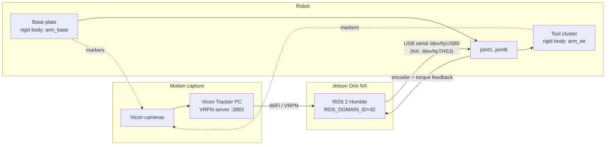
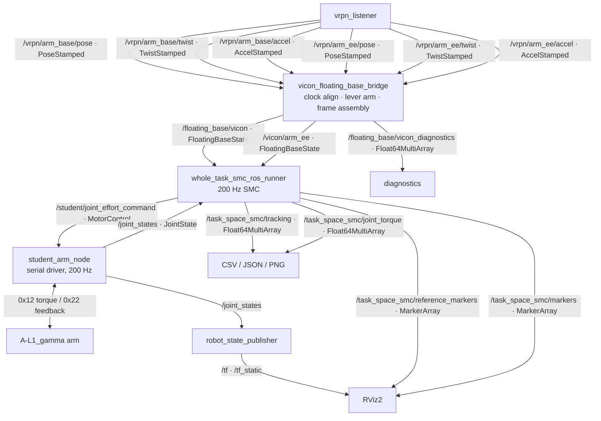
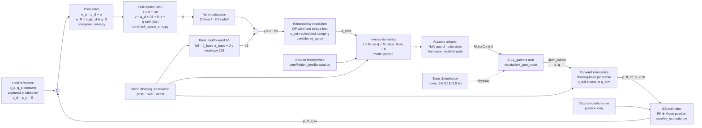
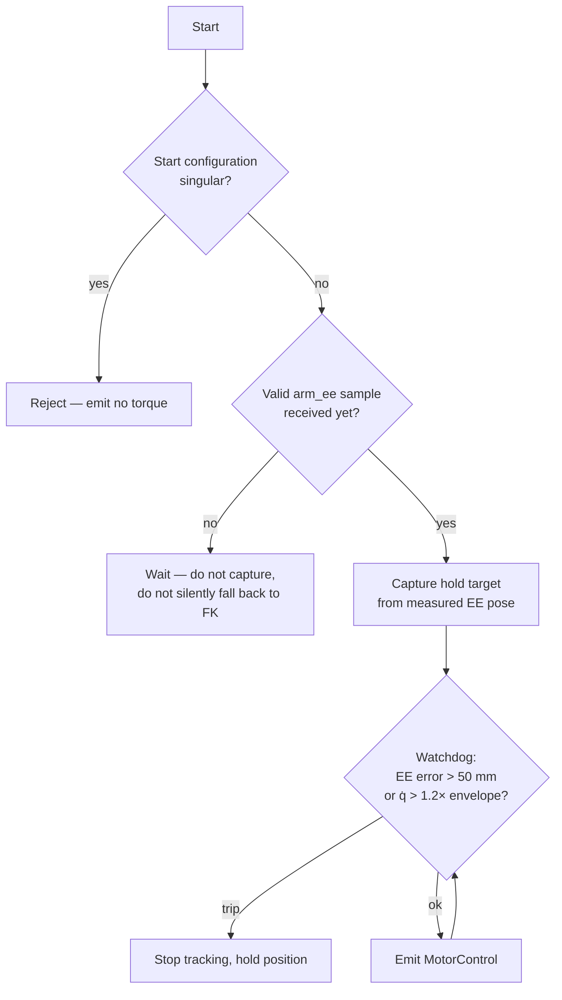

# End-Effector Stabilization Under Base Disturbance — Architecture Notes

Scope: the **demo2 / `hold`** path — *基座随便动，末端不动*. Base pose comes from motion
capture, the end-effector reference is a constant world pose, and every millimetre of
error is attributable to base motion that was not cancelled.

Entry point: `vicon_hold_demo.launch.py` → `hw/whole_task_smc_ros_runner.py`
with `trajectory_shape=hold`, `base_state_mode=vicon`, `mode=hardware`.

---

## 0. Glossary

### Vicon

Yes — **Vicon is a brand of optical motion-capture system**, the way "Kleenex" is a brand
of tissue. Infrared cameras track retroreflective markers; a server PC solves marker
clusters into 6-DOF rigid-body poses at ~125 Hz (measured frame interval **8.017 ms,
σ = 0.474 ms**) and streams them over the network via **VRPN** (Virtual-Reality
Peripheral Network, a standard tracker protocol).

This rig defines two rigid bodies:

| Rigid body | Markers on | What the controller takes from it |
|---|---|---|
| `arm_base` | arm base plate | pose, linear + angular velocity, linear + angular acceleration |
| `arm_ee` | tool / wrist cluster | **position only** (see §4) |

Server on this setup: `192.168.200.60:3883` (confirmed 2026-08-25, and now the
default in both Vicon launch files). Earlier notes list `172.16.20.21` and
`192.168.200.78`; both are stale.

### σ_min-scheduled damping

"Scheduled" = *gain scheduling*: the parameter is not a constant, it is a function of a
measured quantity — here the **smallest singular value $\sigma_{\min}$ of the (scaled) arm
Jacobian**, which is the standard distance-to-singularity measure.

The joint accelerations come from a damped, inertia-weighted generalized inverse
(`core/redundancy_resolution.py:57`):

$$
\bar{J} \;=\; M^{-1} J^{\mathsf{T}} \left( J M^{-1} J^{\mathsf{T}} + \lambda^{2} I \right)^{-1}
$$

With $\lambda = 0$, the gain along a singular direction is $1/\sigma$, which $\to \infty$ as the arm
approaches a singularity: a millimetre of task command asks for an unbounded joint
acceleration, and the torque spikes into the limiter. With damping, that gain becomes
$\sigma/(\sigma^2 + \lambda^2)$, which peaks at $1/(2\lambda)$ — **bounded**. The price is a steady-state
tracking bias, because a damped inverse is no longer an exact inverse.

So you want $\lambda$ large only *near* a singularity. `adaptive_damping()`
(`redundancy_resolution.py:28`) interpolates it linearly:

$$
\lambda \;=\;
\begin{cases}
\lambda_{\min} = 5 \times 10^{-5}, & \sigma_{\min} \ge \sigma_{\text{warn}} \\[4pt]
\lambda_{\max} = 0.03, & \sigma_{\min} \le \sigma_{\text{crit}} \\[4pt]
\text{linear interpolation}, & \text{otherwise}
\end{cases}
$$

`smc_params_hold.yaml`: `sigma_warn: 0.03`, `sigma_critical: 0.012`. Note the null-space
projector $N = I - \bar{J}_0 J$ is deliberately built from the **undamped** SVD inverse
(`_undamped_inverse`) — a damped $\bar{J}$ is not idempotent, and using it would leak
null-space motion into the task.

### EKF2

**PX4's onboard state estimator** — an Extended Kalman Filter shipped as the `ekf2`
module. It fuses IMU (gyro + accelerometer) with GPS, barometer, magnetometer, optical
flow, rangefinder and external vision/mocap, and outputs attitude, position, velocity,
and IMU bias estimates.

It is relevant here because **on a UAV, EKF2 is what replaces Vicon as the base state
source**. The catch: EKF2's primary outputs are pose and velocity. Acceleration is not a
first-class output, and differentiating its velocity at 200 Hz is noisy. On a UAV you
would instead take the bias-corrected IMU specific force (which *is* a direct
acceleration measurement) and rotate it into the world frame — see §7.

### `b6` and why the acceleration channel is "sensitive"

`b6` is the **task-space bias acceleration**: the end-effector acceleration produced by
base motion and velocity-product (Coriolis/centrifugal) terms *when the joints are not
accelerating*. Formally, differentiating $\dot{x} = J_{\text{full}}\, v$ twice:

$$
\ddot{x}_{\text{ee}} \;=\; J_{\text{arm}}\,\ddot{q}
\;+\; \underbrace{\bigl( J_{\text{base}}\,a_{\text{base}} + \dot{J}\,v \bigr)}_{b_6}
$$

`model.py:265 compute_task_bias_acceleration()` computes exactly the bracket by calling
forward kinematics once with $\ddot{q} = 0$.

The controller then solves $J_{\text{arm}}\,\ddot{q} = \nu - b_6$ (`runner:2190`). This is a **feedforward**
path, and that is the whole point of the sensitivity remark:

> Feedback errors get corrected by the loop. **Feedforward errors get injected into it.**

`b6` is *subtracted* from the commanded task acceleration $\nu$. So an error δ in `b6`
appears one-for-one as δ of spurious commanded end-effector acceleration — unity gain,
no filtering, no attenuation. Base *linear* acceleration passes into `b6` through the
translational block of `J_base`, which is the identity, so the map is 1:1.

Hence `linear_acceleration_noise_std_m_s2: 0.04` in `smc_params_whole6.yaml:79` — that
0.04 m/s² of sensor noise becomes 0.04 m/s² of broadband noise on the commanded task
acceleration, at 200 Hz, straight through $\tau = M\ddot{q} + \dots$ into the torque command. For
scale, `max_linear_task_accel` is 3.0 m/s², so it is ~1.3% of full scale — persistent,
white, and directly heating the motors. Contrast with `position_noise_std_m: 0.0003`,
which enters through the error term where it is at least shaped by the loop.

The same argument applies to `angular_acceleration_noise_std_rad_s2: 0.015`, amplified by
the lever arm $\alpha \times r$ out to the tool.

### Does Vicon latency matter?

**Yes — it is the dominant reason the end-effector feedback is structured the way it is.**

Measured on this setup (`core/ee_estimator.py:1`): transport delay **mean 171 ms,
p95 432 ms, max 964 ms**, against a **200 Hz** control loop with an equivalent position
gain of **$k\lambda = 144\ \mathrm{m}^{-1}$**.

Two different consequences, because the base state feeds *two* paths:

| Path | Effect of latency |
|---|---|
| **Feedback** (EE position → error → SMC) | Pure dead time = phase lag $2\pi f \tau$. At the 0.5–0.9 Hz base motion band, 171 ms ≈ **43° of phase loss**. Enough to eat the phase margin and turn a stable loop into a ringing one. 171 ms is also ~34 control periods — you would be reacting to where the tool was a fifth of a second ago. |
| **Feedforward** (base accel → `b6`) | You cancel the *wrong* acceleration — the one the base had 171 ms ago. Guarded by `base_state_timeout_sec: 0.15`, which refuses to emit torque on stale base data. |

The designed answer is `ee_feedback.mode: vicon_bias_corrected`:

$$
p \;=\; p_{\text{fk}} + b,
\qquad
b \;=\; \mathrm{LPF}_{0.2\,\mathrm{Hz}}\!\bigl( p_{\text{vicon}} - p_{\text{fk}} \bigr)
$$

FK from encoders carries the high frequency (millisecond latency, but drifts due to
calibration error); Vicon corrects only a slowly-varying offset, at a bandwidth where
171 ms is a small fraction of a cycle. Steady state still converges to Vicon truth.

> ⚠️ **`smc_params_hold.yaml` currently sets `mode: vicon_direct`, not
> `vicon_bias_corrected`** — i.e. raw, latent Vicon position *is* in the fast loop today,
> with `velocity_source: vicon`. If the hold demo rings or drifts, this is the first knob
> to turn.

A separate timing problem, already solved: the Vicon server clock differs from the arm PC
by ~12 h, but its *differences* are excellent while local arrival times jitter 0.09–180 ms
over WiFi. Differentiating on arrival time inflated velocity by ~90×. `SourceClockAligner`
(`core/base_state_fusion.py:37`) therefore **differentiates on the source clock and
timestamps on the local clock**.

### What `flight_status_bridge` actually bridges

`src/ros_nodes/flight_status_bridge.cc`. **mavros** is the ROS↔MAVLink bridge that talks
to a PX4 flight controller. This node subscribes to two mavros topics and republishes
them into the arm's namespace:

| In | Type | Out | Type | Content |
|---|---|---|---|---|
| `/mavros/state` | `mavros_msgs/State` | `/flight/armed` | `std_msgs/Bool` | **only the `armed` flag** is extracted — motors armed yes/no |
| `/mavros/battery` | `sensor_msgs/BatteryState` | `/flight/battery` | `sensor_msgs/BatteryState` | forwarded verbatim |

`mavros_msgs/State` also carries `connected`, `guided`, `mode` and `system_status`; the
bridge drops all of them. More importantly, **it carries no pose, velocity, or
acceleration**. Nothing this node publishes can feed base compensation — it is
housekeeping telemetry only. That is why it is a stub with respect to the UAV problem:
the node that would matter, a `/mavros/local_position/odom` → `FloatingBaseState`
converter, does not exist yet.

---

## 1. Physical layout



---

## 2. ROS computation graph



### Why `FloatingBaseState` instead of three topics

```
std_msgs/Header      header
geometry_msgs/Pose   pose
geometry_msgs/Twist  twist
geometry_msgs/Accel  acceleration
```

Pose, velocity and acceleration of one rigid body travel in **one message under one
timestamp**. The bridge does the cross-channel time alignment once
(`max_cross_channel_skew_sec: 0.004`, i.e. under half a Vicon frame); downstream never
has to re-solve it. The `arm_ee` path deliberately reuses the same message type rather
than repeating that work.

### Services

**The real-time control path uses no ROS services at all** — it is topics end to end, and
there are no `.srv` definitions in this workspace. The only service clients are the
standard `rcl_interfaces/srv/GetParameters`, used by the offline calibration scripts
(`hw/phase2_torque_probe.py:99`, `phase3_gravity_calibration.py:105`,
`phase4_gravity_compensation.py:121`, `phase5_inertia_id.py:101`, `fk_gravity_verify.py:682`)
to read parameters off `student_arm_node`.

This is deliberate: a service call is a blocking request/response round trip, which has no
place inside a 5 ms control period.

### Safety note on `ROS_DOMAIN_ID`

Hardware runs on domain **42**, simulation on **77**. The protocol has **no
enable/disable frame** — there is no software E-stop, only physical power-down — so a
stray simulation node publishing onto the hardware domain is a real hazard, not a
nuisance.

---

## 3. The control loop



**Read the diagram as two paths that meet at $y = \nu - b_6$:**

- The **feedback path** (top) is the sliding-mode controller reacting to world-frame pose
  error. It has bandwidth, phase margin, and it corrects whatever is left over.
- The **feedforward path** (`b6`) cancels the base motion *open loop*, before it becomes
  error. This is where the performance comes from: the base is treated as a **measured
  exogenous input**, not as an unknown disturbance to be estimated after the fact.

That is why the demo can hold ~1.71 mm RMS against a moving base instead of lagging by
the feedback bandwidth.

### The math, in order

**1 — Error, world frame** (`core/pose_error.py:37`)

$$
\begin{aligned}
e_p &= p_d - p, &\qquad \dot{e}_p &= v_d - v \\[2pt]
q_{\text{err}} &= q_d \otimes q^{-1}, &\qquad R_{\text{err}} &= R(q_{\text{err}}) \\[2pt]
e_R &= \log(q_{\text{err}}) \in \mathbb{R}^{3}, &\qquad e_\omega &= \omega_d - R_{\text{err}}\,\omega \\[2pt]
\dot{e}_R &= J_l^{-1}(e_R)\,e_\omega, &\qquad J_l &= \text{SO(3) left Jacobian}
\end{aligned}
$$

Because the error is defined on the **world** pose of the tool, base motion shows up as
task error automatically. No special case is needed.

**2 — Sliding-mode law** (`core/task_space_smc.py:82`)

Position channel:

$$
\begin{aligned}
s_p &= \dot{e}_p + \Lambda_p\, e_p \\[4pt]
a_{\text{cmd}} &= a_d + \Lambda_p\, \dot{e}_p + K_p\, s_p + \eta_p \tanh\!\left( \frac{s_p}{\phi_p} \right)
\end{aligned}
$$

Substituting back gives $\dot{s}_p = -K_p s_p - \eta_p \tanh(s_p/\phi_p)$, so $s_p \to 0$, after which
$e_p$ decays exponentially at rate $\Lambda_p$.

Inside the boundary layer the closed loop is $(s + \Lambda_p)(s + K_p + \eta_p/\phi_p) = 0$, giving a
steady-state error under constant disturbance $d$:

$$
e_{\text{ss}} \;=\; \frac{d}{\Lambda_p \left( K_p + \dfrac{\eta_p}{\phi_p} \right)}
$$

With hold gains $\Lambda_p = 18$, $K_p = 8$, $\eta_p/\phi_p = 4$, the denominator is $18 \times 12 = 216$.

$\tanh(s/\phi)$ replaces $\operatorname{sign}(s)$: at a finite 200 Hz sample rate a true sign function
chatters. $\phi$ is the boundary-layer half-width — the price is that disturbance rejection is
now finite rather than exact.

Attitude channel is the same construction on SO(3), with the extra $J_l$, $\dot{J}_l^{-1}$ terms
needed to convert between $\ddot{e}_R$ and the angular acceleration command.

**3 — Base cancellation** (`runner:2187`)

```python
b6 = model.compute_task_bias_acceleration(q_full, v_full, bs_est.acceleration_lwa)
rhs_task = smc.nu - b6
```

**4 — Joint accelerations.** Either the QP (`task.solver: qp`, used by `hold`) with torque
limits as hard constraints, or the damped dynamically-consistent pseudo-inverse:

$$
\begin{aligned}
\ddot{q} &= \bar{J}\,y + N\,\ddot{q}_{\text{null}},
\qquad N = I - \bar{J}_0 J \\[4pt]
\ddot{q}_{\text{null}} &= -K_p^{\text{null}} (q - q_{\text{nom}})
- K_d^{\text{null}} \dot{q} + k_{\text{lim}} \nabla \mathrm{limit}(q)
\end{aligned}
$$

**5 — Torque** (`model.py:283`), with the base acceleration entering as inertial coupling:

$$
\tau_{\text{arm}} \;=\; M_{aa}\,\ddot{q}_{\text{cmd}} + M_{ab}\,a_{\text{base}} + h_a(q, v)
$$

### Rates and budgets

| Stage | Rate / value | Constraint |
|---|---|---|
| Vicon frame | 125 Hz (8.017 ms, σ 0.474 ms) | source clock is trustworthy; arrival clock is not |
| Vicon transport | mean 171 ms, p95 432 ms | WiFi; drives the EE feedback design |
| SMC loop | 200 Hz (5 ms) | QP must converge inside it (`max_iterations: 40`) |
| Serial torque mode | ≤ 200 Hz | board reports 200.6 Hz; faster starves feedback |
| Serial position mode | ≤ 100 Hz | `ExecuteControlCycle` throws for `dt < 0.01` |
| Base staleness gate | 150 ms | `base_state_timeout_sec` — no torque on stale base |
| Joint staleness gate | 100 ms | `joint_state_timeout_sec` |
| Watchdog | 50 mm EE error, 1.2× velocity envelope | acts on **measurements**, never estimator output |

### Safety interlocks



The watchdog deliberately consumes **measured** values, not estimator outputs: the
estimator is the thing under test on this path, so the backstop must not share a failure
mode with it.

---

## 4. Frame conventions — and the EE asymmetry

| Symbol | Frame | Meaning |
|---|---|---|
| `world` | fixed | controller world; with `zero_on_first_pose:=true` it is **defined by the first base pose** |
| `_lwa` | LOCAL_WORLD_ALIGNED | origin **on the body**, axes **parallel to world** |
| `_w` | world | expressed in world axes |
| free-flyer `v[:6]` | **base body frame** | pinocchio convention — see §7 |

Vicon world is y-up with joint1's axis along x; the bridge rotates everything into the
controller world via `world_from_vicon_quaternion_xyzw`, then optionally re-zeroes on the
first base pose.

**The end-effector is measured asymmetrically, and this is a deliberate, evidence-driven
choice** (`core/ee_estimator.py:1`):

- **Attitude is always FK, in every mode.** The `arm_ee` cluster axes sit 114.39° / 113.54°
  from `link6` across two calibrations. The constant repeats to 0.85°, but the residual
  after removing it was 9.97° one run and **43.55°** the next — a single fixed rotation
  does not explain that channel. Root cause: joint6's zero offset is the one uncalibrated
  entry in `arm6_calibration.yaml`, and it is *mathematically inseparable* from the marker
  cluster's roll.
- **Position is fused**, per §0.
- The control point is the **marker cluster origin, not `link6`**. Both the Jacobian and
  the bias acceleration are transported to it:

  $$
  J_p' = J_p - [r]_\times J_\omega,
  \qquad
  b_p' = b_p + b_\omega \times r + \omega \times (\omega \times r)
  $$

  The centripetal term $\omega \times (\omega \times r)$ survives at constant angular velocity — omitting it
  produces an error no static test can see. The 17.9 mm offset is invisible in a static
  check and very visible once the arm moves.

---

## 5. Simulation dry-run

`task_space_smc_whole6_sim.launch.py trajectory_shape:=hold` runs the same control code
against an injected base instead of Vicon. The injection deliberately **keeps the sensor
imperfections** — mocap is not an ideal sensor and the dry run should not pretend it is:

| Injected | Value |
|---|---|
| Base translation | A = [10, 8, 6] mm at [0.5, 0.7, 0.9] Hz |
| Base attitude | [3.0, 2.5, 2.0]° at [0.45, 0.65, 0.85] Hz |
| Base estimator delay | 20 ms |
| Base linear accel noise | 0.04 m/s² → straight into `b6` |
| Gusts | 1−cos pulses, 0.8 s wide, every 4 s |
| Motor | 12 ms drive delay, scale error, bias, ripple 11–17 Hz |

`demo/moving_base_trajectory_config.py:855` bands the disturbance at **0.15–2.5 Hz** with
the explicit comment *模拟无人机悬停漂移+抖动* — UAV hover drift and jitter. The `gust`
and `fault` profiles (the latter a DC bias over a window, simulating a flight-control
anomaly) already exist.

---

## 6. UAV feasibility summary

| Transfers as-is | Needs work |
|---|---|
| Floating-base model is already a pinocchio free-flyer — the UAV case | Base state from EKF2, not Vicon (§0) |
| World-frame error definition | Acceleration source: use IMU specific force, not differentiated EKF2 velocity |
| `b6` feedforward structure | Frame convention — **§7** |
| Disturbance band already modelled at 0.15–2.5 Hz | Arm reaction torque back onto the airframe is modelled nowhere |
| `FloatingBaseState` interface | `/mavros/local_position/odom` → `FloatingBaseState` node does not exist |

---

## 7. The frame-convention mismatch

*This is the item worth acting on before anything flies.*

### The two conventions

**Pinocchio's free-flyer joint velocity and acceleration are expressed in the joint's own
LOCAL frame — that is, the base body frame.** This is standard pinocchio and is stated
correctly in the repo at `core/model.py:200`:

> `# base_velocity 表达在【基座体系】，不是世界系`

**But every base quantity flowing through this codebase is `_lwa`** —
LOCAL_WORLD_ALIGNED, meaning origin on the body but **axes parallel to world**. The bridge
rotates Vicon's native twist/accel into the *controller world* frame
(`hw/vicon_floating_base_bridge.py:419 _r_ctrl_from_vicon`), not into the body frame.

These two agree **if and only if $R_{wb} = I$.**

### Where the two meet without a conversion

```python
# runner:1799, 1856, 2355
v_full_ctrl = self.model.make_v_full(bs.velocity_lwa, self.qd_ctrl)

# runner:2187, 2214
b6  = self.model.compute_task_bias_acceleration(q_full, v_full, bs_est.acceleration_lwa)
tau = self.model.compute_rnea_arm_torque(q_full, v_full, bs_est.acceleration_lwa, qdd)
```

World-frame vectors go straight into slots that pinocchio interprets as body-frame. The
repo already knows the correct conversion — `core/base_state.py:104` spells it out:

$$
\begin{aligned}
v_{\text{body}} &= R^{\mathsf{T}} v_w \\[2pt]
a_{\text{body}} &= R^{\mathsf{T}} a_w - \omega_{\text{body}} \times v_{\text{body}}
\end{aligned}
$$

...and then `SimulationInjectedBase.sample()` returns world-frame values anyway, into the
same slot.

### Why it is invisible today

1. **`zero_on_first_pose:=true`** (demo2, §5.3.5) redefines the controller world using the
   first base pose. At $t = 0$, $R_{wb} = I$ **exactly**.
2. The base is bolted to a desk edge. It barely rotates.
3. The simulated base attitude amplitude is only 3° / 2.5° / 2°. At 3°,
   $\cos 3^\circ = 0.9986$ — a **0.1%** error, far below the noise floor.
4. **The unit tests cannot catch it.** `test/core/test_floating_base_model.py:38` builds
   `v_full` with `make_v_full(bs.velocity_lwa, …)` and then validates the Jacobian against
   a finite difference built the *same* way. The convention cancels on both sides of the
   comparison. This is a consistent-but-unverified assumption, not a tested one.

### Why a UAV breaks it

A multirotor tilts to translate — that is the only way it generates horizontal force. 10°
to 20° of roll/pitch is routine, not exceptional.

For a base velocity or acceleration vector $x_w$ of magnitude $|x|$, the error from
skipping the rotation is $|x_w - R x_w| = 2|x|\sin(\theta/2)$:

| Base tilt $\theta$ | Feedforward error |
|---|---:|
| 3° (desk today) | 0.1% |
| 10° | **17%** |
| 15° | **26%** |
| 20° | **35%** |

And the error is not noise — it is **systematic and correlated with the manoeuvre**. The
tilt is largest exactly when the base is accelerating hardest, which is exactly when `b6`
matters most. The feedforward would degrade precisely where it is load-bearing.

Worse, this is a feedforward path (§0): the error is injected at unity gain, not corrected
by the loop.

### The fix

Convert once, at the boundary where external base state enters the controller — not at
each of the five call sites, which is how conventions drift apart in the first place.
Candidate location: `_base_for_control()` (`runner:2135`), or make `make_v_full` /
`make_a_full` take world-frame input and rotate internally, so the convention is enforced
by the type rather than by a comment.

```python
R = bs.rotation_wb
v_body = np.concatenate([R.T @ bs.velocity_lwa[:3],
                         R.T @ bs.velocity_lwa[3:]])
omega_body = v_body[3:]
a_body = np.concatenate([R.T @ bs.acceleration_lwa[:3] - np.cross(omega_body, v_body[:3]),
                         R.T @ bs.acceleration_lwa[3:]])
```

Then add a test that a **pure base rotation with the base held at a non-identity
attitude** produces the correct end-effector velocity — that is the case the current test
suite structurally cannot fail.

> Note this is a *latent* issue, not a present-day bug: on a desk-mounted base with
> `zero_on_first_pose`, the current code is correct to within 0.1%. The point is that the
> masking condition is exactly the condition a UAV removes.
